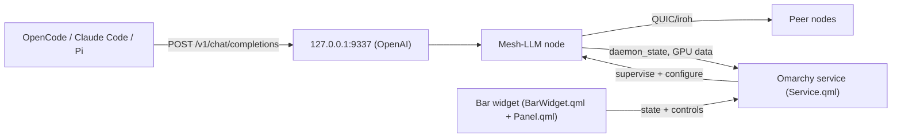

# Omacelium

[Mesh-LLM](https://github.com/Mesh-LLM/mesh-llm) 0.78.1 (Apache-2.0).
Plugin license: MIT. This repository is unaffiliated with either project.

| | |
|---|---|
| **Status** | Early development (M1 supervisor wired) — not yet installable from Omarchy |
| **Type** | Omarchy plugin: bar widget + service |
| **What it does** | Runs a local Mesh-LLM node with a bar icon, a panel, and a stable OpenAI-compatible endpoint |
| **Requires** | Omarchy (Arch Linux + Hyprland), Mesh-LLM, a GPU with a few GB of VRAM for meaningful contribution |

## Why

You have maybe one GPU; AI coding agents want the whole GPU. Omacelium pools
spare VRAM from nearby machines into one shared inference pool and gives every
agent on your machine a single stable endpoint — regardless of which of your
machines is actually serving.

It is deliberately a **thin control plane** on top of Mesh-LLM. It owns:

- a **bar widget** — icon + live state (`Mesh on`, `Serving peers`, `Standing by`, `Offline`), click to open the panel
- a **supervised process** — start, crash-restart with backoff, port-conflict handling, and a clean leave on shutdown
- a **panel** — join toggle, contributed-VRAM slider, model hosting with upstream fit data, private invite tokens
- a **stable endpoint** — `http://127.0.0.1:9337/v1`, so `lel` points agents at one URL no matter how the mesh routes

Serving, model routing, P2P transport (iroh/QUIC), NAT traversal, model
downloads, and layer splitting stay upstream. The plugin reimplements none of
them.

## Install

```sh
mesh-llm --version   # check Mesh-LLM is present
omarchy plugin add https://github.com/ewweberlin/omacelium
```

Mesh-LLM is not installed as a side effect. The plugin never installs system
packages or downloads binaries on its own; when it is missing, the panel offers
an explicit install (Arch package / official installer / AUR) that you confirm.

### First run

1. Enable the widget; the service probes `127.0.0.1:3131` (console) and `:9337` (OpenAI API).
2. Flip **Join mesh**; your slider position (`Contributed GPU memory`, 10–100 %) is mapped to Mesh-LLM's `--max-vram`.
3. Point an agent at `http://127.0.0.1:9337/v1` and use model name **`auto`** — Mesh-LLM routes by model to whoever hosts it.

For one box and no mesh, that's already a normal local model server. For two
boxes and a household, that's the point.

## Privacy: read this once

Every inference and every prompt goes over an encrypted QUIC link between
nodes; relays only see ciphertext. But every mesh is a set of *computers*, and
the computer that runs a model for your request necessarily has that prompt in
memory. There is no feasible confidential-computing path today.

So:

- **Local-only** — nothing leaves. ✓
- **Private mesh (trusted owners)** — only owners you explicitly invite. ✓ but trust
  is a *decision*, not a proof: someone on a trusted machine can read a prompt
  they serve.
- **Community mesh** — anyone can be serving your request. ✗

Omacelium therefore defaults to private/standalone, never ships community mode
as "private" (see the security notes in this README), and shows a
consent screen before any mesh mode.

## Configuration

Bar settings live in `~/.config/omarchy/shell.json`; sensitive state (invite
tokens, process state) stays in `~/.local/state/omarchy/ewweberlin.omacelium/`
with `0700` directories and `0600` files, never written to `shell.json`,
logs, or panels.

| Setting | Values | Behavior |
|---|---|---|
| `enabled` | bool | Join / leave the mesh |
| `contributionPct` | 10–100 | Slider → `--max-vram`; compute shown in GB from `mesh-llm gpus --json` |
| `hostedModels` | list | Allow-list; a model not on it never loads |
| `meshMode` | `public` / `private` | Private default: invite token, no public publish |
| `agentEndpoint` | bool | Endpoint on / off |
| `pauseOnActivity` | bool | Delegate idle/lock/suspend to Mesh-LLM's `[runtime.activity]` policy |

### Ports in use

`9337` and `3131` are fixed so agents get one stable URL. If they are taken the
panel tells you by whom and offers *Use it* (adopt) / *Stop it*; it does not
silently change ports.

## Architecture

- `State.js` / `MeshApi.js` / `Settings.js` — pure logic, unit-testable without QML
- `bin/omacelium-node` — POSIX `sh` CLI: probe/diagnose the node from a terminal



## Development

```sh
node --test lib/           # state machine and policy math; no QML needed
sh -n bin/omacelium-node   # shell syntax
qmllint *.qml              # QML lint; target is Omarchy, not macOS
omarchy plugin validate    # manifest sanity
```

The repo you see is a design/scope checkout; install, test, and validate on an
Omarchy machine.

## License

MIT. Not affiliated with [Mesh-LLM](https://github.com/Mesh-LLM/mesh-llm)
(Apache-2.0) — model weights you host carry their own licenses, and the plugin
never implies otherwise.
